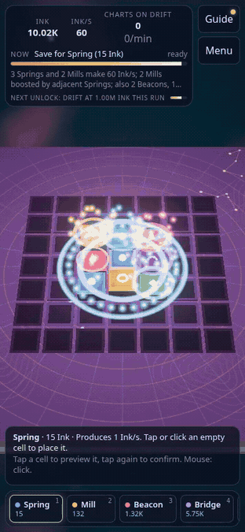

# Hyperbolic Cartographer

An incremental game about placing tiles on a hyperbolic plane. Live at **https://aieatassam.github.io/hyperbolic-cartographer/**



*Real 10-second capture at 390x844, normal playback speed, no panning. The GIF is resized to 312x675 at 8 fps (about 2.2 MB) to keep it small. Dev-panel grants were used to show progression quickly.*

## What it is

You earn Ink from tiles, and a tile's output depends on its neighbours. The board starts as a flat square grid, where each cell touches 4 neighbours. Projection switches it to a hyperbolic {7,3} tiling, where each cell touches 7. Ring sizes on that board are 1, 7, 21, 56, 147. The same adjacency rules matter much more there.

## First steps

1. **Springs** produce Ink. Ink buys tiles.
2. Place a Spring, then save for a **Mill**. Mills produce more Ink, boosted by each adjacent Spring.
3. **Adjacency** is the core idea. Beacons multiply neighbours, and Bridges link their neighbours together.
4. **Survey** adds a ring of cells. Each ring costs more.
5. **Drift** ends the run, keeps pinned tiles, and turns run Ink into **Charts**. It unlocks at 1,000,000 Ink in a run.
6. **Projection** spends Charts, switches to the hyperbolic board, and resets the run.
7. **Curvature** is earned in Projection. It and its upgrades survive Drift and Projection.

Tiles (from `TILE_INFO` in `src/core/tiles.ts`):

- **Spring**: produces Ink.
- **Mill**: produces Ink, +100% per adjacent Spring.
- **Beacon**: adjacent tiles x1.5 (stacks multiplicatively).
- **Lighthouse**: producers exactly two steps away x1.25 (stacks). Bridges do not extend its reach.
- **Trade Wind**: a wind occasionally blows in during live play. Catch it from the HUD chip for a burst of Ink and a short x3 Ink/s surge. Surges do not carry into offline progress.
- **Bridge**: its neighbours count as adjacent to each other. Long Bridges extends the reach.
- **Vault**: improves offline progress and adds a small global Ink bonus.

Other controls:

- **Sell**: removes a tile for a 50% refund.
- **Pin**: pins a tile so it survives Drift. Pin slots are limited; Brass Pins adds more.
- Disabled buttons show a line saying what is missing.
- Some upgrades automate play: Survey Crew (auto-Survey) and Well Diggers (auto-place Springs).

## Touch, mouse and keyboard

**Touch and pen**

- First tap previews the cell in the card above the tools: cost, Ink/s change, or why it's blocked.
- Second tap on the same cell, or **Place**, confirms. **Cancel** or **Esc** clears the preview.
- Drag pans. Pinch zooms. Drags, pinches and cancelled touches never place.
- Hyperbolic edge cells shrink. Centre moves the previewed cell into the middle without buying or changing zoom.

**Mouse**

- Click places at once. Hover previews cost and Ink/s change.
- Drag pans. Right-drag tilts the view. Scroll to zoom.
- In hyperbolic mode, dragging applies a Lorentz boost, so the board slides like a hyperbolic plane.

Hover is never required: everything it shows is also available by tapping.

**Keyboard**

- **1-5**: select a tile tool.
- **S**: Sell tool. **P**: Pin tool. Then click or tap a cell.
- **Esc**: closes an open dialog, or cancels the current preview. On small screens it also closes the side panel.
- **`** (backtick): toggles the dev panel, where enabled (see below).

Keys are ignored while focus is in a text field, with Ctrl/Cmd/Alt held, or while a dialog is open.

## Tutorial and panels

- The first run shows a 5-step tutorial above the tools: Ink buys tiles, place your first Spring, save for a Mill, the adjacency boost, and reading the preview. Each step moves on once its goal is met.
- **Hide** dismisses the card. The **Guide** button reopens it.
- The Menu's Guide tab has tutorial controls and a reference for every tool and button.
- Tutorial progress is stored in `localStorage` under `hc-tutorial`, separate from your save.
- The top bar shows **Now** (your next step, with progress and an ETA), a live line about what the board is producing, and the next unlock.
- Panels scroll. Close them with **Close** or **Menu**.
- All controls are at least 44px.

## Saves

- Autosave to `localStorage` every 10 s, when the tab is hidden, and before a prestige.
- Export as a compressed string, or download `cartographer-save-<date>.json`.
- Import accepts either format. It checks the schema and an FNV-1a checksum, and shows a preview before anything is replaced.
- Importing or hard-resetting keeps a one-slot backup of the previous save (`hc-save-backup`).
- Offline progress is capped at 8 h, plus 4 h per Ship's Log level. It runs at 50% base efficiency, plus 10% per Vault, up to 100%. Offline time is simulated in 60-second steps. Auto-Springs only run while the game is open.

## Sound and music

- Each stage has its own music: Survey, Drift, Projection, the torus and Klein bottle Manifold previews, and (ahead of their gameplay) Dimension and Horizon. Each has 3 or 4 tracks, played in shuffled order with 6-second crossfades. Stage changes crossfade over 4 seconds, and the music dips under Drift and Projection transitions, so nothing cuts off abruptly. [docs/audio/music-by-stage.md](docs/audio/music-by-stage.md) lists the tracks and why each one fits.
- Every tile has its own instrument: Spring harp, Mill marimba, Beacon glockenspiel, Bridge pizzicato strings, Vault low piano. Choosing a tool plays a softer version. Notes come from a major pentatonic scale in the key of the track that is playing, so effects harmonise with the music.
- Other effects: UI clicks, a quiet water drop when Ink arrives (at most one every 1.6 s), Survey, upgrades, pins, selling, constellations, network links, invalid placements, and Drift, Projection and Manifold transitions. Automation bursts are capped at 5 placement sounds per second.
- **Menu → Settings → Sound** has Music and Sound effects sliders and a mute button. The speaker button in the top bar, next to Guide and Menu, mutes and unmutes at any time. Settings are stored in `localStorage` under `hc-audio`.
- Sound starts on the first tap, click or key press (browser autoplay rules; this also unlocks audio on iOS Safari). It drops to 20% while the tab is hidden.
- Files are WebM/Opus, with an AAC `.m4a` fallback for browsers without Opus, in `public/audio/`. They are not bundled: a stage's music streams only when that stage plays, and the sound effects (about 230 KB) load after the first gesture. `python3 scripts/audio/build-audio.py` rebuilds them from the sources in `src/audio/assets.json` (needs ffmpeg).
- `?music=<stage>` (`survey`, `drift`, `projection`, `torus`, `klein`, `dimension`, `horizon`) forces a stage's playlist, for example to hear Dimension and Horizon before their gameplay exists.

## Performance

There is no guaranteed 60 fps. Frame rate depends on the device and GPU. The renderer lowers its quality automatically on slower devices and on phones.

## Local development

```sh
npm install
npm run dev         # then open http://localhost:5173/hyperbolic-cartographer/
npm test            # Vitest, core logic only, runs in Node
npm run typecheck
npm run build
npm run preview     # serve the production build
npm run pacing      # headless greedy bot; slow and opt-in
npm run layout      # layout QA; after npm run build and npx playwright install chromium
```

- `python3 scripts/audio/build-audio.py` re-encodes `public/audio/` and regenerates `AUDIO-CREDITS.md` (needs ffmpeg with libopus; not part of CI).
- `npm run pacing` asserts the first Drift comes before 15 minutes and Projection before 90 minutes of game time.
- Layout QA setup: `npm run build`, then `npx playwright install chromium`, then `npm run layout`. See [Layout QA](#layout-qa).
- The dev panel toggles with the backtick key. It is on in dev builds, and in production builds when the URL has `?dev`. It can grant currency, jump to Drift or Projection, and change time speed.

## Testing with the fast clock

Two ways to see a whole run quickly, both on the same simulation rules as live play:

- **Live, in the browser (dev only):** `npm run dev`, then open the app with `?dev&speed=N` (N from 1 to 1000; `speed` is clamped and ignored in production builds). Economy and Trade Winds run N times faster. From the console, `window.game` exposes `setSpeed(x)`, `pause()`, `resume()`, `step(seconds)` (advance simulated time at once), `snapshot()`, `cells()`, `place(i, t)`, `sell(i)`, `survey()`, `catchWind()`, `drift()` and `project()`. Add `qa` (`?dev&qa`) to keep the run out of localStorage.
- **Headless:** `npm run playtest` runs the greedy bot for 120 minutes of game time (`MIN=60 npm run playtest` for less), prints a timeline with milestones, wall time and peak heap, and exits 1 if Drift is not before 15 minutes or Projection is not before 90 minutes.

Trade Winds come up on the simulated clock, so a fast run sees the same wind schedule per game minute. The core pieces are `fastForward` in `src/core/tick.ts` and the timer in `src/core/wind.ts`; `tests/fast-clock.test.ts` covers them.

## Deploy

`.github/workflows/deploy.yml` runs on every push to `main` (and on manual dispatch). The `build` job runs typecheck, test and build and uploads the Pages artifact. In parallel, a `layout` matrix runs six jobs, one per viewport, each doing its own `npm ci`, build and Playwright Chromium install, then `npm run layout` with `LAYOUT_VIEWPORT` set to that viewport. The matrix is not fail-fast, so every viewport reports. A failing viewport uploads its `layout-artifacts/` as `layout-artifacts-<viewport>`. Deploy waits for `build` and all six layout jobs and runs only if every one passes; it then deploys `dist` to GitHub Pages. Locally, `npm run layout` still runs all six viewports; set `LAYOUT_VIEWPORT=<WxH>` (for example `LAYOUT_VIEWPORT=360x640`) to run just one while debugging.

One-time setup: in the repo's **Settings → Pages**, set **Source** to **GitHub Actions**.

`base` in `vite.config.ts` is `/hyperbolic-cartographer/`. Change it if the repo is renamed, or asset paths will break.

## Layout QA

`npm run layout` drives the built app in headless Chromium at six viewports: phone portrait (360x640, 390x844, 430x932), phone landscape (844x390, 932x430), and desktop (1280x800) and checks overflow, overlap, tap-target size and reachability, plus per-case expectations for tutorial, tabs, modals, import/export, and offline.

- Run `npm run build` first (the script serves `dist/` with `vite preview`), or set `LAYOUT_URL` to a running build including the base path.
- Set `LAYOUT_SHOTS=1` to screenshot every case. Failures always write `layout-artifacts/<viewport>-<case>.png` and `layout-artifacts/report.json`. Set `LAYOUT_OUT=<dir>` to write them somewhere else (for example, to keep parallel runs apart).
- Needs Playwright's Chromium: `npx playwright install chromium`. The script uses [Playwright](https://playwright.dev) (Apache-2.0).
- CI runs it after the build (15-minute step timeout per viewport; 1280×800 on GitHub-hosted SwiftShader needs more than 8 minutes if every case reloads the app) and uploads `layout-artifacts/` when it fails. Each case line prints duration in ms; `layout-artifacts/report.json` includes `ms` and `totalMs`.

## Design documents

- [Full game design](docs/design/full-game-design.md): the complete design, including future layers; the playable slice does not implement it all.
- [Geometry and rendering roadmap](docs/art/geometry-roadmap.md): proposed C0–C7 work for surfaces, particles, cameras and accessible picking. Documentation only; no new layer is implemented.

## Architecture

```
src/
  core/        pure, deterministic, Node-testable; no DOM, no Three
    config.ts      every tunable number
    tiles.ts       tile types and TILE_INFO
    economy.ts     costs, production, placement, prestige gains
    tick.ts        simulate(state, dt) and offline catch-up
    state.ts       GameState; GRAPHS built once at max size
    prestige.ts, milestones.ts, save.ts
    geometry/      TileGraph (ring[], neighbours[][]), square.ts, hyperbolic.ts (Lorentz 3x3)
  render/        Three.js scene, board mesh, effects and framing
  ui/            plain DOM overlay (styled in src/style.css); help, tutorial and input logic
  audio/         music and sound effects: stage playlists, tuned cues, settings UI; assets.json lists every file
  main.ts        fixed 10 ticks/s simulation + requestAnimationFrame render loop
tests/           Vitest suites, plus the opt-in pacing bot
```

- Game logic never knows its geometry. It only sees a `TileGraph` (`ring[]`, `neighbours[][]`). Tile indices stay stable, and Survey just raises `state.ring`.
- Every tunable number lives in `src/core/config.ts`.
- The simulation runs at a fixed 10 ticks/s through `simulate(state, dt)`. Rendering runs on requestAnimationFrame and reads state.
- Hyperbolic geometry uses the hyperboloid model with 3x3 Lorentz matrices. Rendering projects to the Poincaré disk.
- `save.ts` is pure (strings in, strings out). Only `main.ts` touches `localStorage`. Save changes add a `migrations[v]` entry and bump `SAVE_VERSION`.

## Balance

Changes from the original brief (all in `src/core/config.ts`; formulas unchanged):

- Mill output 5 → 9 Ink/s (pacing: first Drift was ~25 min).
- Lighthouse: cost 50,000 Ink, x1.25 to producers two steps away (`config.tiles.lighthouse`).
- Trade Winds: appear every 40–80 s of live play for 14 s; catching pays max(30 s of Ink/s, 25 Ink) and grants a 20 s x3 surge (`config.wind`).
- Survey growth 8^ring → 6^ring on the square board (base 50).
- Charts on Drift = floor((runInk / 2.5e5)^0.5) instead of /1e6 (Drift still unlocks at 1e6 Ink); otherwise Projection took > 2 h.
- Hyperbolic survey: base 2e5, growth 12^ring; board starts at radius 2, base max radius 3, +1 via the "Deeper Horizon" Curvature upgrade (radius 4 = 232 tiles).
- Offline base efficiency 50% (unspecified in brief).
- 2026-11 balance pass: `startInk` 22, `costGrowth` 1.12, Mill cost 85, Spring out 1.15, Drift at 2.65e5 Ink, first Mill/Bridge Ink rewards (`npm run sim-economy` for casual/greedy milestones).
- Bot results with these numbers: casual first Drift ~11 min (greedy ~8); Projection pacing unchanged from prior bot notes.
- Manifold preview grids (visual only, not economy): torus **16×8**, Klein **8×8**; framing/spin/demo pulse rates in `config.manifold`.
- Manifold 3D flow (visual only): the tiling slides over the surface so far-side and interior cells come to you. Drag the torus to spin it (x) or roll it through the hole (y); drag the Klein bottle vertically to glide tiles through the neck, horizontally to turn it; right-drag orbits the camera. `dragFlow` **0.0025** turns/px, `idleFlow` **0.012** turns/s (off with reduced motion), tile patch subdivision `patchSubdiv` **6**.
- Portrait playable framing: `camera.portraitPolar` 0.55 rad and `portraitTopPad` 18 px so a square board fills more of the HUD-to-dock band without clipping (width still limits size; leftover height sits above the info card).

## Credits and related works

**Dependencies**

- [Three.js](https://threejs.org/): rendering.
- [break_eternity.js](https://github.com/Patashu/break_eternity.js): large-number arithmetic.
- [lz-string](https://github.com/pieroxy/lz-string): save compression.
- [Vite](https://vitejs.dev/): build and dev server.
- [Vitest](https://vitest.dev/): tests.

**Art.** All art is original and procedurally generated in code. Textures are drawn at runtime, the backdrop is a GLSL shader, and reflections come from a generated environment. No image, font, HDR or model files are loaded. See `docs/art/style-guide.md`, and `docs/art/particle-language.md` for the particle effects.

**Audio.** Music and sound effects are by other artists, all CC0 or CC BY (no NC, ND or SA). Full details, including every sound-effect sample, are in [AUDIO-CREDITS.md](AUDIO-CREDITS.md), and the same list is in the game under Menu → Settings → Music and sound credits.

| Stage | Track | Author | Licence | Source |
|---|---|---|---|---|
| Survey | Calm Piano 1 (Vaporware) | The Cynic Project (cynicmusic) | CC0 1.0 | https://opengameart.org/content/calm-piano-1-vaporware |
| Survey | Air | Alexandr Zhelanov | CC BY 4.0 | https://opengameart.org/content/air |
| Survey | Meditation Impromptu 02 | Kevin MacLeod (incompetech.com) | CC BY 4.0 | https://incompetech.com/music/royalty-free/mp3-royaltyfree/Meditation%20Impromptu%2002.mp3 |
| Survey | Calm Ambient 1 (Synthwave 4k) | The Cynic Project (cynicmusic) | CC0 1.0 | https://opengameart.org/content/calm-ambient-1-synthwave-4k |
| Drift | November Snow | The Cynic Project (cynicmusic) | CC0 1.0 | https://opengameart.org/content/november-snow |
| Drift | Calm Ambient 2 (Synthwave 15k) | The Cynic Project (cynicmusic) | CC0 1.0 | https://opengameart.org/content/calm-ambient-2-synthwave-15k |
| Drift | Dreamy Flashback | Kevin MacLeod (incompetech.com) | CC BY 4.0 | https://incompetech.com/music/royalty-free/mp3-royaltyfree/Dreamy%20Flashback.mp3 |
| Projection | Crystal Cave (song18) | The Cynic Project (cynicmusic) | CC0 1.0 | https://opengameart.org/content/crystal-cave-song18 |
| Projection | Mysterious Ambience (song21) | The Cynic Project (cynicmusic) | CC0 1.0 | https://opengameart.org/content/mysterious-ambience-song21 |
| Projection | Crypto | Kevin MacLeod (incompetech.com) | CC BY 4.0 | https://incompetech.com/music/royalty-free/mp3-royaltyfree/Crypto.mp3 |
| Manifold (torus) | Global Resonance | Eponasoft | CC0 1.0 | https://opengameart.org/content/global-resonance |
| Manifold (torus) | Contemplation | Joth | CC0 1.0 | https://opengameart.org/content/contemplation-0 |
| Manifold (torus) | Echoes of Time v2 | Kevin MacLeod (incompetech.com) | CC BY 4.0 | https://incompetech.com/music/royalty-free/mp3-royaltyfree/Echoes%20of%20Time%20v2.mp3 |
| Manifold (Klein bottle) | Futuristic Ambient 1 | Alexandr Zhelanov | CC BY 4.0 | https://opengameart.org/content/futuristic-ambient |
| Manifold (Klein bottle) | Futuristic Ambient 4 | Alexandr Zhelanov | CC BY 4.0 | https://opengameart.org/content/futuristic-ambient |
| Manifold (Klein bottle) | Unwritten Return | Kevin MacLeod (incompetech.com) | CC BY 4.0 | https://incompetech.com/music/royalty-free/mp3-royaltyfree/Unwritten%20Return.mp3 |
| Dimension | Observing The Star | yd | CC0 1.0 | https://opengameart.org/content/another-space-background-track |
| Dimension | Space Atmosphere | Alexandr Zhelanov | CC BY 3.0 | https://opengameart.org/content/space-atmospere |
| Dimension | Lightless Dawn | Kevin MacLeod (incompetech.com) | CC BY 4.0 | https://incompetech.com/music/royalty-free/mp3-royaltyfree/Lightless%20Dawn.mp3 |
| Horizon | Infinite Perspective | Kevin MacLeod (incompetech.com) | CC BY 4.0 | https://incompetech.com/music/royalty-free/mp3-royaltyfree/Infinite%20Perspective.mp3 |
| Horizon | Space Music: Out There | yd | CC0 1.0 | https://opengameart.org/content/space-music-out-there |
| Horizon | Harmony in the Mists | Tsorthan Grove | CC BY 4.0 | https://opengameart.org/content/harmony-in-the-mists |
| Horizon | Singularity (calm version) | vitalezzz | CC0 1.0 | https://opengameart.org/content/singularity-0 |

Sound effects:

- VSCO 2 Community Edition (orchestral samples) by Versilian Studios (Sam Gossner, Simon Dalzell) (CC0 1.0): https://github.com/sgossner/VSCO-2-CE
- Interface Sounds by Kenney (kenney.nl) (CC0 1.0): https://opengameart.org/content/interface-sounds
- 51 UI sound effects (buttons, switches and clicks) by Kenney (kenney.nl) (CC0 1.0): https://opengameart.org/content/51-ui-sound-effects-buttons-switches-and-clicks

**Related works.** These are named for context only:

- HyperRogue: a well-known game set in hyperbolic geometry.
- Antimatter Dimensions: a well-known incremental game.

They are listed only as context for readers, not as inspiration or sources. No assets or code from either are used. This project is independent and is not affiliated with or endorsed by their creators.

## License

MIT. See [LICENSE](LICENSE).
